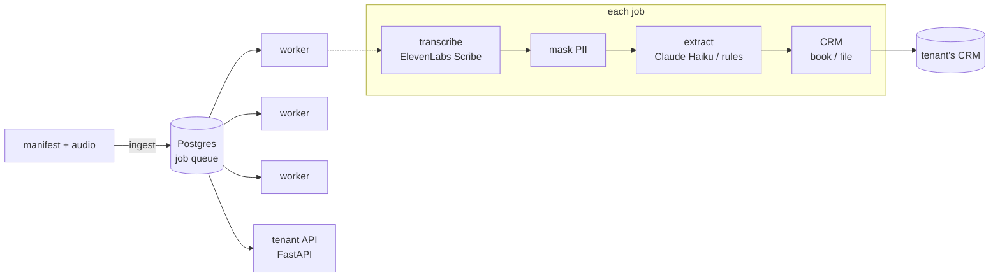

# call-recording-pipeline

A multi-tenant pipeline that turns Turkish call-center recordings into CRM actions: it transcribes each call,
masks personal data, reads out meeting requests and complaints, and books meetings and files complaints in the
company's CRM.

The core rule: **no recording may be lost or silently skipped**, even though the speech-to-text API, the LLM and
the CRM all fail now and then. A recording either finishes or stops at a named step with the reason, and can be
resumed from that step without being uploaded again.

> The recordings this was built and tested on belong to a private company and are not included. The repository
> shows how the system works; the results below come from runs on that data and from the test suite.

## What it does



| Step | What happens |
|---|---|
| **ingest** | Registers every recording in the manifest and queues it. A byte-identical re-upload (same sha256) is linked to the original and never reaches the CRM twice. A recording whose audio is missing still gets a row, and fails visibly. |
| **transcribe** | ElevenLabs Scribe, one channel per speaker (agent / caller), with word timings and log-probabilities. |
| **mask** | Names, phone numbers, emails, TC ID numbers, card numbers, IBANs. Checksums (Luhn, TCKN) only choose the label: any run of 10+ digits is masked, since speech-to-text can mishear a digit. Names are learned from the call itself ("adım …", "… Bey", the answer to "adınız?"); company names are kept, because the team needs to know who called. The raw transcript is deleted in the same transaction that stores the masked one. |
| **extract** | Claude Haiku reads the masked call and returns a meeting request (day, time, topic, online / in person) and/or a complaint, as a validated schema. Words the recogniser was unsure of (low logprob) are flagged `⟨?⟩` so the model doesn't take them literally. Without an API key, a rule-based extractor takes over. |
| **crm** | Turns "tomorrow evening at six" into a timestamp against the *call's* time, picks the earliest free slot at or after it, books it, and writes a note for the team. Complaints are filed with a one-line summary. |

## Design highlights

**A queue without a queue server.** Jobs live in a Postgres table; a worker owns a job by holding a
session-level advisory lock on its connection. If the worker dies, its connection closes and Postgres releases
the lock at once, so the next worker takes the job over. No lease timeouts, no reaper process, and a worker that
lost its connection can no longer write, so it can't overwrite the new owner's progress. (`app/queue.py`)

**Resume from the failed step.** Each job remembers its step. Errors are classified: *transient* (retried with
exponential backoff, then `failed`), *permanent* (a bad API key: failed at once with the reason), *deferred*
(the step can't run yet; waits without using an attempt). `app.reprocess` restarts failed jobs from where they
stopped; finished steps are never repeated. (`app/pipeline.py`)

**Exactly one booking per call, even when the CRM loses its answer.** Every CRM write is stored in the database
*before* it is sent, with its exact bytes and an idempotency key. If a worker dies mid-request, or the CRM commits
the write and drops the connection, the next attempt re-sends the same bytes with the same key instead of picking
a new slot. After a database wipe, existing CRM entries are recognised by `call_id` and adopted.
(`app/steps/crm.py`, `migrations/005_crm_actions.sql`)

**Calls are booked in the order they came in.** Slots are scarce, so a call that came in later must not take a
slot from an earlier one just because its worker was faster. Only one worker talks to a given CRM at a time (an
advisory lock per CRM, the "lane"), and a call waits (bounded) for earlier calls of the same tenant to reach the
CRM first. Requests to the CRM are paced under its rate limit using the database clock, so the pacing survives a
worker hand-over.

**Tenant isolation in the database, not only in the code.** Every tenant table has forced row-level security;
the tenant is set per transaction, and with no tenant set the policies match nothing. The API runs as a
restricted database role that can't read raw transcripts or API keys, and the tenant comes only from the API
key (a `?tenant=` or `X-Tenant` header is ignored). Another tenant's recording returns `404`, the same as a
missing one.

**Personal data never leaves masked.** Logs, error messages, the LLM and the CRM only ever see masked text.

## When things break

[`scripts/drill.sh`](scripts/drill.sh) starts the whole stack with the CRM in chaos mode (429s, 500s, 8-second
stalls, lost responses), breaks it scenario by scenario, and checks after each one that every recording
finished, the CRM has at most one booking and one complaint per call, and no raw transcript is left.
Results on a 21-call run:

| Scenario | Result |
|---|---|
| `kill`: 2 of 3 workers killed, one during a CRM write | 21/21 done, no duplicates |
| `kill_all`: every worker killed with 12 jobs unfinished, then restarted | 21/21 done, no duplicates |
| `scale`: 5 workers, then 1 | 21/21 done, no duplicates |
| `bad_key`: wrong speech-to-text key from the start | 20 `failed (transcribe)` (HTTP 401) + the duplicate done; after fixing the key and reprocessing, 21/21 |
| `key_breaks`: key broken after 5 transcriptions | 6 done, 15 `failed (transcribe)`; reprocess resumed exactly those 15 |
| `crm_down`: CRM stopped during the CRM step | 13 `failed (crm)` with the reason; after restart and reprocess, 21/21, no duplicates |
| `db_restart`: Postgres restarted with 12 jobs unfinished | each worker restarted once; 21/21, no duplicates |
| `up_again`: start command run a second time | nothing new in the CRM |
| `db_reset`: our database deleted, the CRM kept | nothing new in the CRM, no duplicates |

What we learned along the way: Docker does not restart a container that was `docker kill`ed (it counts as a
manual stop), so if every worker is killed the queue simply waits for `docker compose up -d`. Nothing is lost.

## Tests

187 tests, each run in its own throwaway database:

```bash
docker compose run --rm --build tests
```

They cover the queue under concurrent workers, a worker killed while its CRM request is in flight (and the
delayed request landing at the worst moment), lost CRM responses, slots taken between looking and booking,
call-order booking when workers pick calls up in reverse, tenant isolation through both the database roles and
the HTTP API, masking rules, time parsing, and the speech-to-text and LLM adapters' error handling.

The CRM tests run against [`crm_mock/`](crm_mock/), a small stand-in CRM (standard library only) with the same
failure modes as a real third-party API.

## Running it

You need Docker with Compose v2 and an [ElevenLabs](https://elevenlabs.io) key; an Anthropic key is optional.

```bash
cp .env.example .env               # set ELEVENLABS_API_KEY (and ANTHROPIC_API_KEY for LLM extraction)
# put each tenant's calls in data/<tenant>/: manifest.json + the audio files it lists
docker compose up -d               # Postgres, one CRM mock per tenant, migrations, ingest, 3 workers, API on :8000
docker compose run --rm cli app.status --wait 900
```

A manifest lists recordings as `{"id", "tenant_id", "file", "recorded_at"}`; tenants and their CRM URLs are in
[`config/tenants.json`](config/tenants.json). Audio is expected as two-channel phone recordings (agent and caller
on separate channels).

```bash
docker compose up -d --scale worker=5                     # any number of workers
docker compose run --rm cli app.reprocess [--tenant brightsmile] [--recording rec_004]
docker compose run --rm cli app.api_keys create brightsmile   # prints a key once; only its hash is stored
curl -s localhost:8000/meetings -H "Authorization: Bearer $KEY"
```

API: `GET /recordings`, `/recordings/{id}/transcript` (masked), `/meetings`, `/complaints`; docs at `/docs`.

## Stack

Python 3.12, PostgreSQL 17 (queue, row-level security), FastAPI, httpx, psycopg 3, Pydantic, ElevenLabs Scribe
(speech-to-text), Claude Haiku (extraction), Docker Compose, pytest, uv.

## Known limits and next steps

- **Spoken numbers.** Speech-to-text sometimes writes a phone number as words ("sıfır beş yüz otuz iki"), which
  the pattern-based masking does not catch yet. Next: normalise Turkish number words before masking.
- **Rule-based fallback** reads less well than the LLM: it misses meeting requests phrased without the usual
  words and leaves the meeting topic empty.
- **One connection per worker** for job ownership: fine up to tens of workers, far beyond what the CRM's rate
  limit can use. Beyond that, `app/queue.py` would move to time-based leases.
- Vocabulary hints (custom terms per tenant) for speech-to-text, and a comparison with other LLM providers on
  the same calls.
